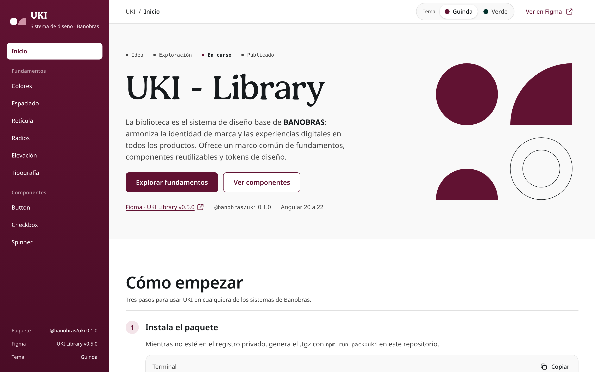
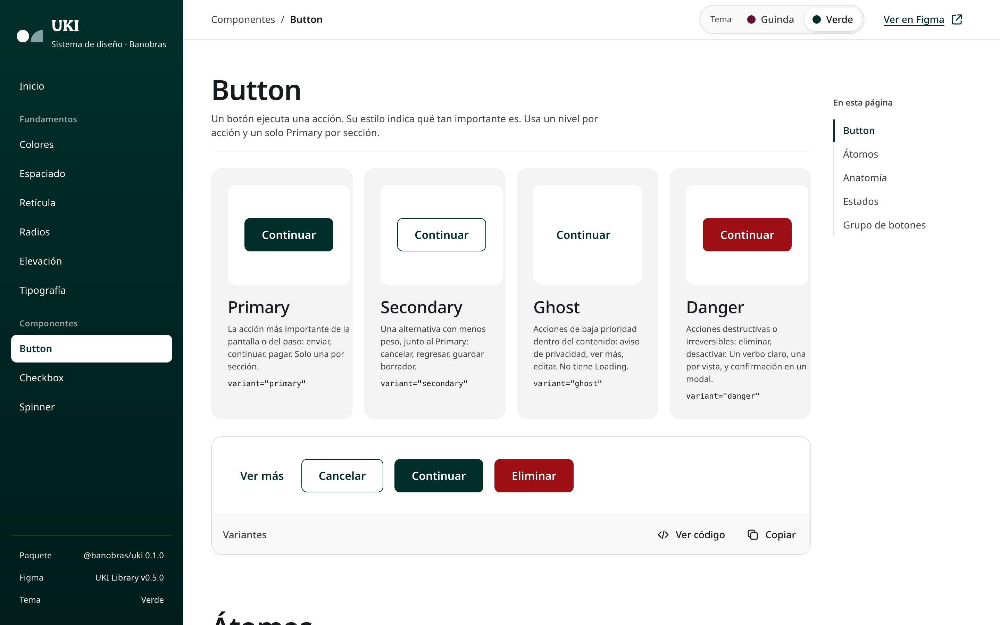
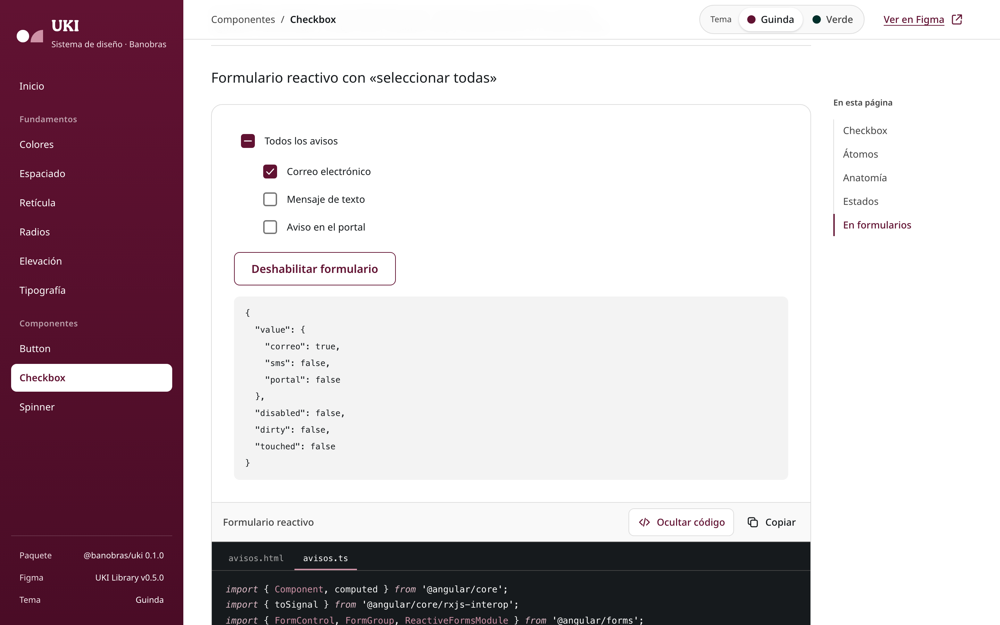
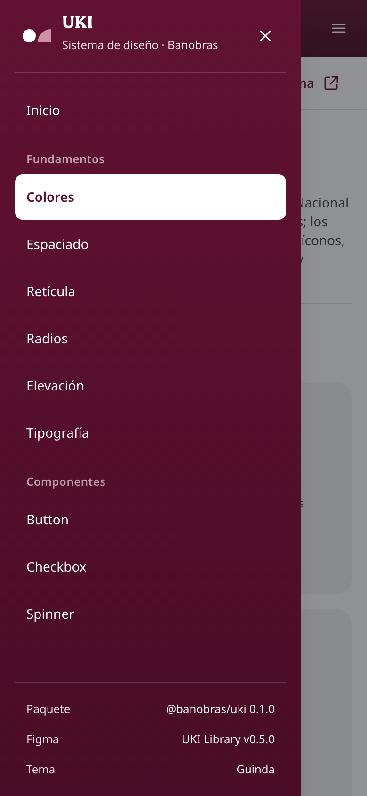

<div align="center">


# @banobras/uki

**Componentes Angular del sistema de diseño UKI de Banobras.**<br>
Un solo paquete para que Portal FONADIN, SISSARR, SAAIPB, SISEC y SIVARMER se vean idénticos.

[](https://angular.dev)
[](https://www.figma.com/design/6fzZVvIfv44dGFePtb5F9n/UKI---Library)
[](#temas)
[](#accesibilidad)
[](projects/uki/package.json)

**[Ver la documentación en vivo →](https://banobras-uki.vercel.app)**

[Inicio rápido](#inicio-rápido) · [Componentes](#qué-incluye) · [Temas](#temas) · [Documentación](#documentación) · [Desarrollo](#desarrollo)

<br>



</div>

## Por qué existe

El Sistema Nacional de Diseño solo se distribuye como CSS y JS por CDN: no hay paquete npm, la URL versionada cambia de contenido sin aviso, `snd.js` no funciona con lo que Angular pinta después y no trae diseño para formularios. Banobras ya tiene su sistema en Figma, **UKI - Library**, con la misma paleta del SND y tokens por componente, pero sin implementación en código.

`@banobras/uki` es esa implementación: tokens generados desde Figma, componentes standalone con signals y una documentación viva para que diseño y QA comparen contra Figma.

## Qué incluye

| Pieza | Selector | API |
|---|---|---|
| **Estilos globales** | `styles/uki.css` | Tokens como variables CSS (`--button-primary`, `--spacing-16`…), temas guinda y verde, fuentes Patria y Noto Sans, clases de texto `uki-heading-1` … `uki-link`. |
| **Button** | `<button ukiButton>` · `<a ukiButton>` | `variant`: `primary` · `secondary` · `ghost` · `danger`<br>`size`: `default` · `large`<br>`loading` · `disabled` · íconos con `ukiButtonLeading` / `ukiButtonTrailing` |
| **Button group** | `<div ukiButtonGroup>` | A la derecha en escritorio; apilado con el Primary arriba en móvil. |
| **Checkbox** | `<uki-checkbox>` | `ControlValueAccessor` · `[(checked)]` · `[(indeterminate)]` · `disabled` · `ariaLabel` |
| **Text field** | `<uki-field>` + `<input ukiInput>` | `label` · `required` · `helper` · `error`; el input nativo conserva `type`, `autocomplete` y `formControlName` |
| **Text area** | `<uki-field [maxlength]>` + `<textarea ukiInput>` | Contador «n/máximo» con límite flexible (el error lo marca el validador) |
| **Select** | `<uki-select>` | `options` · `placeholder` · `label` · `required` · `helper` · `error`; *select-only combobox* de WAI-ARIA con teclado completo |
| **Search** | `<uki-search>` | `size`: `default` (40 px) · `large` (48 px) · `(buscar)` con espera de 300 ms · `resultados` anunciados · × y Esc borran |
| **Spinner** | `<uki-spinner>` | `size`: 24 · 36 · 48 · `label` |
| **Alert** | `<uki-alert>` | `type`: `success` · `info` · `warning` · `error` · `icon` · `dismissible` · `[(open)]`; el mensaje es el contenido (admite enlaces) |
| **Toast** | `UkiToastService` | `success()` · `info()` · `warning()` · `error()` · `show({ type, title, description, duration })`; uno a la vez, anunciado sin mover el foco |
| **Badge** | `<uki-badge>` | `type`: `success` · `info` · `warning` · `error`; la etiqueta es el contenido |
| **Avatar** | `<uki-avatar>` | `name` · `src` · `size`: `xs` 24 · `sm` 32 · `md` 40 · `lg` 48 · `xl` 56 · `status` · `decorative` · `initials` |

> [!NOTE]
> UKI va en la v0.5.0 de Figma y todavía puede cambiar tokens antes de su v1.0.0. El paquete registra la versión que implementa en `uki.figmaVersion` de [`projects/uki/package.json`](projects/uki/package.json).

## Inicio rápido

**1. Instala el paquete.** Mientras no esté en el registro privado, genera el `.tgz` en este repositorio con `npm run pack:uki` e instálalo en tu proyecto:

```bash
npm install ../banobras-snd-ui/dist/uki/banobras-uki-0.1.0.tgz
```

**2. Agrega los estilos globales** antes de los del proyecto, en `angular.json`:

```json
"styles": ["node_modules/@banobras/uki/styles/uki.css", "src/styles.css"]
```

Las fuentes van dentro del paquete: Angular las copia al `dist` y no se pide nada a CDNs externos.

**3. Importa los componentes** que uses; cada uno trae solo su CSS:

```ts
import { Component, signal } from '@angular/core';
import { UkiButton } from '@banobras/uki';

@Component({
  selector: 'app-guardar',
  imports: [UkiButton],
  template: `<button ukiButton type="button" [loading]="guardando()" (click)="guardar()">Guardar</button>`,
})
export class Guardar {
  protected readonly guardando = signal(false);
  protected guardar(): void { /* … */ }
}
```

## Uso

```html
<!-- Botones: el elemento nativo conserva type, foco, teclado y envío de formularios. -->
<button ukiButton type="submit" [loading]="guardando()">Guardar</button>
<button ukiButton variant="secondary" type="button">Cancelar</button>
<button ukiButton variant="danger" type="button">Eliminar</button>
<a ukiButton variant="ghost" routerLink="/aviso">Aviso de privacidad</a>

<!-- Grupo: en el DOM, Ghost → Secondary → Primary. -->
<div ukiButtonGroup>
  <button ukiButton variant="ghost" type="button">Cancelar</button>
  <button ukiButton type="submit">Continuar</button>
</div>

<!-- Checkbox con formularios reactivos, ngModel o [(checked)]. -->
<uki-checkbox formControlName="aceptaTerminos">Acepto los términos</uki-checkbox>
<uki-checkbox [(ngModel)]="avisos">Recibir avisos</uki-checkbox>
<uki-checkbox [(checked)]="todas" [indeterminate]="algunas()" ariaLabel="Seleccionar todas las filas" />

<uki-spinner size="36" label="Cargando resultados" />

<!-- Campos: el error aparece al salir de un campo inválido o al enviar. -->
<uki-field label="Correo electrónico" helper="Te enviaremos el acuse." error="Escribe un correo con el formato nombre@dominio.mx">
  <input ukiInput type="email" autocomplete="email" formControlName="correo" />
</uki-field>
<uki-field label="Motivo" [maxlength]="500" error="Usa máximo 500 caracteres.">
  <textarea ukiInput formControlName="motivo"></textarea>
</uki-field>
<uki-select label="Tipo de trámite" [options]="tramites" formControlName="tramite" error="Elige un tipo de trámite." />
<uki-search placeholder="Buscar por folio o solicitante" ariaLabel="Buscar en la tabla"
            [resultados]="total()" (buscar)="filtrar($event)" />

<!-- Retroalimentación: Error lleva role="alert"; los demás, role="status". -->
<uki-alert type="error" dismissible [(open)]="hayError">
  No pudimos enviar la solicitud. <a routerLink="/requisitos">Revisa los requisitos</a>.
</uki-alert>
<uki-badge type="warning">En revisión</uki-badge>
<uki-avatar name="Mariana López Hernández" src="/fotos/mlopez.jpg" size="lg" status />
```

```ts
// Toast: desde el código, sin nada en la plantilla. Success e Info se cierran a los 5 s; Warning y Error, al cerrarlos.
private readonly avisos = inject(UkiToastService);

guardar(): void {
  this.avisos.success('Solicitud enviada', 'Te enviamos el acuse por correo.');
}
```

<details>
<summary><strong>Detalles de comportamiento</strong></summary>

- `type` no se fija por ti: dentro de un `<form>`, un `<button>` sin `type` envía el formulario, como en HTML.
- `loading` ignora clics y envíos sin quitar el foco y marca `aria-busy`. El texto se oculta a la vista, pero sigue siendo el nombre accesible. La variante `ghost` no tiene loading en UKI.
- En `<a ukiButton disabled>` se cancela la navegación y el enlace sale del orden de tabulación.
- `indeterminate` se apaga cuando la persona hace clic, igual que en el control nativo.
- **Toast** crea una sola región al final de `<body>` con dos regiones vivas fijas (`status` y `alert`); el aviso no toma el foco, se pausa con el puntero encima o el foco dentro, y Esc lo cierra si el foco está dentro. Un aviso nuevo reemplaza al visible.
- **Alert** con `dismissible` se oculta al cerrarlo y lleva el foco al siguiente elemento enfocable.
- **Avatar** sin `src`, o si la foto no carga, muestra las iniciales de `name` (sin «de», «del», «la», «los», «las» ni «y») sobre `brand/primary`. Con el nombre escrito al lado, usa `decorative`.

</details>

## Temas

Guinda es el tema por omisión. Para el verde (proyectos transversales) agrega el atributo a `<html>` o a cualquier contenedor:

```html
<html lang="es-MX" data-uki-theme="verde">
```

Solo cambian los 29 tokens semánticos que dependen de la marca, y todos los componentes lo siguen.

> [!TIP]
> En tus propios componentes usa siempre tokens semánticos (`var(--button-primary)`, `var(--text-brand)`), nunca primitivos (`var(--pguinda-900)`). Así el tema funciona sin tocar código.



## Documentación

La documentación está publicada en **<https://banobras-uki.vercel.app>** (despliegue de prueba en Vercel; se actualiza con cada push a `main`). En local, `npm start` la levanta en <http://localhost:4320>. Sigue la distribución de las páginas de UKI en Figma.

| | |
|---|---|
|  |  |
| **Ejemplos vivos.** Cada ejemplo tiene «Ver código» (pestañas `.html` / `.ts` / `.css` con resaltado) y «Copiar». Los tokens y las escalas de color se copian con un clic. | **Responsiva.** En móvil la navegación vive en un menú lateral; en escritorio hay índice «En esta página» y anterior/siguiente. |

Incluye **Fundamentos** (colores, espaciado, retícula, radios, elevación y tipografía) y **Componentes** (Alert, Avatar, Badge, Button, Checkbox, Search, Select, Spinner, Text area, Text field y Toast, con la distribución de cada página de Figma: Overview, Átomos o Moléculas, Anatomía y Estados, Tipos o Tamaños), además de un selector de tema y un enlace a Figma en cada página.

## Accesibilidad

- WCAG 2.1 AA verificado con axe en todas las páginas de la documentación, en escritorio y en móvil, y con los dos temas.
- Controles nativos (`<button>`, `<a>`, `<input type="checkbox">`): teclado, foco y lectores de pantalla sin reinventarlos.
- Foco visible con borde exterior que no depende solo del color, y Spinner con `prefers-reduced-motion`.
- Compatible con CSP con nonce: no genera atributos `style` ni scripts en línea; los estilos de componente siguen `ngCspNonce` de Angular.

## Desarrollo

Requiere Node 24.11.1 o posterior.

| Comando | Qué hace |
|---|---|
| `npm start` | Documentación en <http://localhost:4320> |
| `npm test` | Pruebas unitarias (Vitest) |
| `npm run lint` · `npm run typecheck` | ESLint y TypeScript |
| `npm run build:uki` | Compila la librería en `dist/uki` |
| `npm run pack:uki` | Genera `dist/uki/banobras-uki-<versión>.tgz` |
| `npm run e2e` | Playwright + axe sobre la documentación |
| `npm run tokens` · `npm run tokens:check` | Regenera `tokens.css` desde Figma y comprueba que esté al día |
| `npm run verify:consumo` | Instala el `.tgz` en aplicaciones nuevas de Angular 20.3 y 22.2 y las compila (Angular 22.2 exige Node 24.15+) |

<details>
<summary><strong>Estructura del repositorio</strong></summary>

```text
projects/
  uki/                 Librería @banobras/uki
    src/lib/           button, button-group, checkbox, spinner, field, select, search,
                       alert, toast, badge, avatar
    styles/            uki.css → fonts.css, tokens.css (generado), base.css
    tokens/            uki-figma.json, exportado de Figma
    fonts/             Patria y Noto Sans, con sus licencias
  demo/                Documentación (Angular)
e2e/                   Playwright + axe
scripts/               generar-tokens.mjs, verify-consumo.sh
docs/sdlc/             Intención, especificación y plan
```

</details>

### Cuando UKI publique una versión nueva

1. Exporta otra vez las variables de Figma a `projects/uki/tokens/uki-figma.json` (formato `nombre|tipo|valor por modo`).
2. `npm run tokens` regenera `styles/tokens.css`. No se edita a mano.
3. Actualiza `uki.figmaVersion` en `projects/uki/package.json` y sube la versión del paquete: menor si UKI solo agregó tokens, mayor si renombró o quitó alguno.
4. Corre todas las pruebas y revisa la documentación contra Figma.

## Pendientes antes de publicar

> [!WARNING]
> **Licencia de Patria.** Noto Sans va recortada a latín en woff2 (72 KB en lugar de 4.3 MB) con su licencia OFL. Patria va sin cambios y su licencia debe confirmarse antes de publicar el paquete. Ver [`projects/uki/fonts/LICENCIAS.md`](projects/uki/fonts/LICENCIAS.md).

- Registro privado y responsable de publicar versiones.
- Comparar con Figma la estela del Spinner y los íconos del Checkbox.
- Comparar con Figma los íconos dibujados (`check-circle`, `info-circle`, `exclamation-triangle`, `x-circle`, `x`) y confirmar con diseño las iniciales del Avatar sin foto y el relleno de Badge.
- Componentes siguientes de UKI: Modal, Breadcrumbs y Table (Radio aún no existe en UKI). Modal tiene que resolver la región de avisos de Toast dentro de un diálogo abierto.

La intención, la especificación y el plan, con sus decisiones y desviaciones, están en [`docs/sdlc/`](docs/sdlc/).
